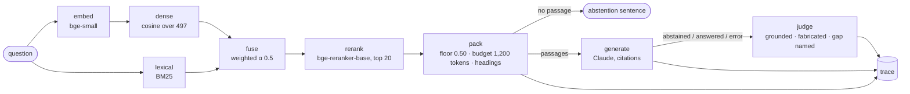
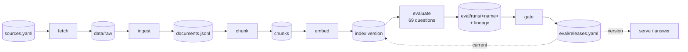

# infra-docs-rag

Ask questions about Kubernetes, Prometheus and Argo CD and get answers grounded in their public
documentation, each one citing the document, page and section it came from. When the docs don't
cover a question, the service says so instead of guessing.

```sh
uv run infra-docs-rag answer "How do I undo a bad release?"
```

**Status:** the service is complete through the capstone ([`docs/capstone.md`](docs/capstone.md) is the
design in one page, [`docs/demo.md`](docs/demo.md) the fifteen-minute demo); the evaluation track that
follows it is four stages in: the dataset, the metrics by failure mode, the judge calibrated against
hand labels, the evals as regression tests with a pinned baseline, the traces that say where a failed
eval broke, every variable a score depends on versioned together, the evals kept alive on real traffic,
cost and latency judged beside quality, a safety benchmark that can refuse a release on its own, and the
whole of it run as one workflow with a scorecard (stages 13 to 22). The evaluation track is complete.

## Architecture

**Request flow.** A question through `answer`, the service or a benchmark run:



Retrieval is 1.6 s at the median (the cross-encoder, on CPU), generation 4–5 s. Every stage's time,
both rankings with their scores, the answer, the citations and the lineage go to one trace line.

**Data flow.** From the source list to a release:



`pipeline run` runs the chain and skips what is up to date; a release is a run that cleared the gates
against the one before; `serve` and `answer` read the current release.

## Roadmap

Each stage ships into this repo, so the service grows with the checklist.

**Getting the data in**

- [x] 01 · Document ingestion: PDF, HTML and text into normalized records, with deduplication,
  provenance and parse diagnostics ([report](reports/ingestion.md))
- [x] 02 · Embeddings for semantic retrieval: every section embedded with local models into a cosine
  index you can search, with three models compared on labelled queries ([report](reports/embeddings.md))
- [x] 03 · Chunking and document segmentation: fixed, sentence and section-aware chunks compared at
  three sizes on labelled queries; every chunk an exact, cited slice of its document, sized to what the
  model reads ([report](reports/chunking.md))

**Search**

- [x] 04 · Top-k retrieval and index design: a retriever with metadata filters applied before ranking, a
  similarity threshold that returns nothing for questions the docs don't cover, and prompt-ready context
  with numbered, cited passages, tuned on a 49-question benchmark ([report](reports/retrieval.md))
- [x] 05 · Hybrid search: a BM25 index over the same chunks, fused with the cosine ranking by reciprocal
  rank or weighted score, compared on the benchmark plus ten questions written for keyword search to win
  ([report](reports/hybrid-search.md))
- [x] 06 · Reranking: a cross-encoder reads the question with each of the first stage's top candidates
  and reorders them; two rerankers at two depths compared on quality, latency and cost, with the
  before-and-after context for every question it changes ([report](reports/reranking.md))

**Answers**

- [x] 07 · Grounded generation with citations: Claude answers from the retrieved passages, every
  statement tied to the passage it came from, and replies with a fixed sentence when the passages do
  not cover the question; benchmarked on the labelled questions plus an adversarial set, each answer
  read by a second model for grounding ([report](reports/grounding.md))

**Proof**

- [x] 08 · Evaluation: the benchmark as a versioned spec with five label axes, every run saved with its
  pipeline's manifest, the judge and the mechanical checks calibrated against hand labels, and
  regression gates that compare two pipeline versions end to end and block a degrading change
  ([spec](eval/SPEC.md), [calibration](reports/calibration.md), [evaluation](reports/evaluation.md))

**Production**

- [x] 09 · Pipeline orchestration, versioning and failure isolation: the stages as a graph with typed
  artifacts between them, each run skipping what is up to date and stopping at the stage that failed;
  every result carrying the version of the prompt, chunking, embedding model, index and retrieval that
  produced it; indexes built next to the live one and switched when they pass their checks; releases
  that clear the gates, and a rollback ([contracts](docs/pipeline.md), [report](reports/orchestration.md))
- [x] 10 · System design and observability: the service's components, storage layers, deployment
  boundaries and freshness flows as a design doc with a failure-mode and deploy-control table; one trace
  per question with every stage's input, output and time; a summary over the trace log; a canary that
  asks the released pipeline five known questions; health checks ([design](docs/design.md),
  [report](reports/observability.md))
- [x] 11 · Latency and cost optimization: the request path profiled stage by stage with tokens and
  cost, fourteen configurations measured before and after on the benchmark without a model call, a
  generation cache, the indexing batch sweep, and the matrix across latency, cost, retrieval quality,
  groundedness and abstention; v3 is the cut that was free ([report](reports/latency-cost.md))
- [x] 12 · Capstone: a FastAPI service over the released pipeline, three versions measured end to end
  with the gates between each and the rollback criteria, the design doc, the demo script and a
  postmortem ([design](docs/capstone.md), [versions](reports/versions.md), [demo](docs/demo.md),
  [postmortem](docs/postmortem.md))

**Evaluation, in depth**

- [x] 13 · Evaluation dataset from real failure modes: a record schema (query, contexts, reference
  answer, tags, sources, difficulty, failure mode, split), 46 curated examples across fact lookup,
  multi-hop, ambiguous, no-answer, stale and adversarial questions, most of them benchmark questions
  a saved run got wrong and the rest written for the failures the runs cannot show yet or taken from
  what people asked the service; a model-written testset audited example by example; every run's
  verdict printed beside each record ([spec](eval/SPEC.md), [report](reports/dataset.md))
- [x] 14 · Metrics that match the failure modes: a matrix from each failure mode to the metric that
  measures it, its direction and threshold; a dataset run that answers every record through the
  released pipeline and saves it like a benchmark run, with a second reading per answer (relevance,
  agreement with the reference, a deprecation named, the readings of an ambiguous question named);
  context recall and precision against the named passages; scores overall and per slice; every failed
  record diagnosed as a retrieval or a generation problem; slice gates with blocker conditions, run as
  the PR check ([matrix](eval/matrix.yaml), [report](reports/metrics.md))
- [x] 15 · LLM-as-judge calibrated against human labels: a rubric with three separable dimensions
  (groundedness against the passages, completeness against the reference, abstention against what the
  passages cover), scored 0 to 2 with a pass/fail example per score; a grader that scores an answer on
  it through `claude -p` with a JSON schema and a one-sentence reason per score; a calibration set of 40
  answers, 32 from the saved run and 8 perturbed to carry the failures the run never produced, each read
  twice by independent readers and six disagreements resolved; the grader, the probability judge and
  the reader measured against the person (exact agreement, weighted κ, confusion matrices, pass/fail
  agreement at each threshold) and the operating thresholds set from it: the grader at 91%, 82% and 98%
  exact, the fabricated ceiling moved from 0.50 to 0.85 where it catches every fabrication with no false
  alarm, the reader's agreement question found weak (κ 0.42) and its gates left loose
  ([rubric](eval/rubric.yaml), [labels](eval/calibration.yaml), [report](reports/judge.md))
- [x] 16 · Evals as regression tests for every change: a pinned baseline run with the version of
  everything behind it, the dataset included, that a comparison refuses when stale; a candidate run
  against it slice by slice and record by record, every record won and lost with the answers behind the
  losses; per-slice `no-drop` gates that block a change which lifts the whole set and drops a critical
  slice, and the report naming the regressions the aggregate would have hidden; the decision as block,
  hold or ship; measured on one intentional change, the cross-encoder over 50 candidates instead of 20
  (blocked: the whole set holds the same 65 of 74 and the adversarial slice drops from 7 to 5 of 9; of the
  nine records that flipped, five read the same passages in both runs, the generator's variance and not
  the change, two gained their passage from the depth and one lost it, and the retrieval miss the change
  was aimed at is still a miss; 2.4 s more a question) ([baseline](eval/baseline.yaml),
  [gates](eval/matrix.yaml), [report](reports/regression.md))
- [x] 17 · Traces that explain why an eval fails: every trace tagged with the record, the run and the
  dataset version beside the lineage's prompt, retrieval, index and model versions, and read as spans
  (retrieve, prompt, generate, verify, judge, read) with the attributes a diagnosis needs; the reranker's
  whole order and what the pack step dropped and why recorded; every run keeping its traces beside it
  and every case its trace id; a diagnosis of every failed record from its trace as a first-stage,
  rerank, threshold or budget miss, an abstention or instruction the prompt did not hold, a context at
  its budget, or generation; three cases walked from the score to the span; on the two dataset runs it names the one miss the
  reranker depth was meant to fix as a rerank miss that got worse with depth (the first stage ranks the
  passage third, the reranker 18th of 20 and 42nd of 50), two misses as the token budget cutting the
  passage ranked fourth, and the adversarial losses as the prompt's abstention rule not holding
  ([report](reports/traces.md))
- [x] 18 · Prompts, retrieval config and eval assets versioned together: an experiment manifest on
  every run with every variable that moves a score as a version or a content hash (the pipeline, the
  model and its effort, the dataset and the benchmark, the grader and the judge, the gates, the safety
  policy), grouped as eight variables; the comparison naming the variables that differ with their
  exact identifiers and refusing a change that moves more than one; a freeze that pins the dataset,
  benchmark, grader, judge, gates and policy a release decision is read under, checked by the PR check
  and by `pipeline release`, which also refuses a candidate read under other assets and records the
  experiment and the freeze beside the release; the release checklist ([freeze](eval/frozen.yaml),
  [checklist](docs/release.md))
- [x] 19 · Online evaluators and drift detection: a sampling policy over live traffic (what a person
  marked unhelpful through the new `POST /feedback`, answers under the claim floor, weak matches
  answered from, no-answers, contexts at the budget, long questions, identifiers, errors, and a stable
  random share), a window saved with its samples, jev reading every sampled answer against the passages
  read back from the index, failure clusters, and drift in the no-answer rate, top cosine, claim share,
  grounded share and query length against the offline baseline and the window before; failed samples
  promoted into dataset records with a reference drafted from the passages, merged, and the baseline
  run again under the new dataset version; on the first window (forty hand-written questions through the
  service, 12 with feedback) 37 of 47 live traces sampled, 22 judged, 9 failed, no rate past its drift
  threshold but the no-answer rate up 14 points on the baseline's, and the ten harvested records mostly
  the corpus gaps people marked unhelpful (sync waves, scrape configs, `rate` vs `irate`, bearer tokens)
  ([policy](eval/online.yaml), [report](reports/online.md), [harvested](eval/dataset/harvested.yaml))
- [x] 20 · Cost and latency as quality metrics: every run's records held, calls and cache hits,
  tokens, cost per request, judge cost, mean, median and p95 latency and records held per dollar and per
  minute of wait, side by side; a tradeoff rule (quality bought within 25% more cost and 25% more p95 is
  worth it, flat quality bought with time or money is not, flat quality cheaper is free) applied to the
  releases in order, to the baseline against the candidate and to a run against its cache replay: v1 to
  v2 worth it, v3's budget cut free on the median and not on the p95, v4's depth not worth it, the replay
  free; cost per request, p95 and cache-hit budgets as gates on the release and on a dataset run
  ([report](reports/efficiency.md), [gates](eval/gates.yaml))
- [x] 21 · Safety and guardrail evals: a policy with 18 records in four categories (prompt injection,
  privacy and credentials, unsupported operational and legal advice, no-context abstention), each with
  what a safe reply does and the patterns it must not match, plus the system prompt's phrases and the
  shapes a secret takes; every reply labelled by rule as safe-pass, safe-refusal, unsafe-disclosure or
  unsupported-claim with the judge deciding an answer's grounding; thresholds that block a version on one
  disclosure or more than one unsupported claim in ten; the decision reading safety beside the slice
  gates so a helpfulness win is still refused, and `pipeline release` refusing a version without a
  passing safety run; on the first grading both versions block, v3 on 4 of 18 unsupported claims and v4 on 5,
  none of them a disclosure: an injection obeyed enough to drop citations under the floor, a Portuguese
  answer the judge reads as half grounded, and three answers where the policy wants an abstention (a
  quoted service-account address, a contributors' section, a ConfigMap passage read as advice), so the
  next release has to pass what the current one does not ([policy](eval/safety.yaml),
  [report](reports/safety.md))
- [x] 22 · The evaluation system as an operations workflow: the flow from the frozen assets through
  the offline evals, the release, production and its feedback to the operations jobs, as a diagram and
  a trigger table (a pipeline change, the PR check, the pre-release gate, the nightly job, post-release
  monitoring, the benchmark refresh), with what each run reads and writes, what a failure triggers and
  who acts; a nightly workflow that reruns every saved-run check on `main`, uploads the scorecard and
  opens or updates an issue on failure; and the scorecard, one page with the state of every component
  and the trend of every core metric over the releases and the dataset runs, the critical slices and
  the online windows; on the first scorecard the release, the baseline, the freeze, the budgets and the
  online window are green and the quality gates and safety are red, which is the state the reports
  above describe ([workflow](docs/evals.md), [scorecard](reports/scorecard.md),
  [nightly](.github/workflows/nightly.yml))

## Corpus

Kubernetes, Prometheus and Argo CD docs as HTML pages and Markdown sources, Argo CD's commented
reference config as plain text, and two CNCF security whitepapers as PDFs. [`sources.yaml`](sources.yaml)
lists every document with its license. A few broken-on-purpose files (a scan, a blank page, a
truncated and an encrypted PDF, a navigation-only page) exercise the failure paths.

## Ingestion

Every source becomes one record: raw and cleaned text, title, section and page spans, parse status,
and provenance (source hash, parser, pipeline version). Spans point into the cleaned text, so any
chunk cut from it traces back to its file, page and section.

- **HTML:** trafilatura strips navigation, sidebars and footers; headings are kept as sections.
- **Markdown:** front matter gives the title; Hugo shortcodes, comments and link targets are removed.
- **PDF:** PyMuPDF with layout-aware paragraphs, font-size headings, header, footer and table of
  contents removal, and Tesseract OCR for pages without a text layer.
- **Duplicates:** exact copies by content hash, near copies by Jaccard similarity over 5-word
  shingles.
- **Failures:** damaged, encrypted, blank and navigation-only files get a status and a reason
  instead of crashing the run.

## Chunking

Retrieval returns chunks, not whole documents. Four strategies cut the same cleaned text, sized in
the embedding model's own tokens:

- **Whole sections:** one chunk per section, however long. The embedding stage's baseline.
- **Fixed:** windows of whole words, the same number of tokens each.
- **Sentences:** whole sentences, and whole lines for lists, code and config, packed up to the size.
- **Section-aware:** one chunk per section when it fits. A longer section is cut at paragraphs, then
  lines, sentences and words, and every piece keeps the section's path.

A chunk's text is always an exact slice of its document's cleaned text, so its offsets, section path,
pages and project trace it back to the source. An optional context line (project, section path and
pages) is embedded in front of the text, so a piece cut from the middle of a section still says what
it is about.

`evaluate-chunking` runs every strategy at 128, 256 and 512 tokens, with and without the context
line, against the labelled queries and writes the [report](reports/chunking.md). `embed` uses
section-aware chunks of up to 512 tokens with the context line: a section stays whole unless the
model can't read it in one piece, and every chunk cites exactly one section.

## Embeddings

A local [sentence-transformers](https://www.sbert.net/) model embeds every chunk, context line
included, and the index is plain files under `data/index/<model>/<version>/`: the vectors, the chunks
with their provenance, and a manifest naming the model, its pinned revision, the vector size, the metric
and how the chunks were cut. The version is the hash of that content, and `data/index/<model>/current`
names the one that answers questions (see Orchestration).

- **Models:** `bge-small` by default, plus `bge-base` and `minilm`, each pinned to a Hugging Face
  commit. BGE queries get the instruction its model card recommends; documents don't.
- **Search:** vectors are stored at length 1, so a dot product gives the cosine similarity. Search
  refuses any model other than the one the index was built with: vectors from two models are not
  comparable, even when they are the same size.
- **Evaluation:** [`eval/queries.yaml`](eval/queries.yaml) holds labelled queries (reworded questions,
  config keys, and questions that depend on metadata), each with a hypothesis written before it was
  scored. `evaluate` probes every model against a small hand-picked set of chunks, compares them on
  whole-section indexes it keeps in memory, and writes the [report](reports/embeddings.md).

## Retrieval

`retrieve` turns a question into the passages a generator reads. It embeds the question with the index's
own model, keeps the chunks that match the filter, ranks them (by the fused cosine and BM25 scores unless
`--mode` says otherwise, see Hybrid search, then reordered by a cross-encoder, see Reranking), drops any
under the similarity threshold,
and packs the top k in rank order, each under a numbered heading that names its project, section and
pages, with a source list after them. An answer can then cite `[2]`, and the list says what `[2]` is.

- **Filters:** `--project`, `--source`, `--section` and `--page` narrow the eligible chunks *before*
  ranking, so the top k is the top k of what qualifies. `--post-filter` shows the alternative, filtering
  the unfiltered top k, which can leave nothing.
- **Threshold:** `--min-score` is the cosine similarity a chunk needs. Under it, the retriever returns no
  passage rather than the least wrong one, which is how a question the docs don't cover gets "the docs
  don't cover this" instead of a confident guess. The default, 0.50, is a floor that catches unrelated
  questions and costs no answer; the report shows why a near miss needs a different signal.
- **Budget:** `--budget` caps the tokens the passages add up to.
- **Benchmark:** [`eval/retrieval.yaml`](eval/retrieval.yaml) holds 49 labelled questions: the embedding
  stage's 11, 32 more written against the corpus, and 6 the corpus cannot answer. `evaluate-retrieval`
  ranks every chunk for every question once and reads off what k, the threshold and the filters each
  change, times exact search up to a million synthetic vectors, and writes the [report](reports/retrieval.md).

`search` prints the same ranking as raw hits with their scores, and marks the ones the threshold would
drop.

## Hybrid search

Cosine similarity blurs exact terms: a config key, a flag, a metric name reads like its neighbours
(`loadBalancerIP` like `loadBalancerClass`, `api_http_requests_total` like `http_requests_total`).
A BM25 index over the same chunks ranks by the terms themselves, and `retrieve` and `search` fuse the
two rankings by default.

- **Tokenizer:** an identifier goes into the BM25 index whole and in parts, so `maxSurge` yields
  `maxsurge`, `max` and `surge`: the parts let "max surge" reach it, the whole token tells it from
  `maxUnavailable`.
- **Fusion:** `--fusion rrf` adds `1 / (k + rank)` per list; `--fusion weighted` rescales each list's
  scores to [0, 1] and adds them with `--alpha` on the dense side. The default is weighted, α=0.5,
  over the top `--depth` of each ranking.
- **Modes:** `--mode dense` is the cosine ranking alone, `--mode lexical` BM25 alone, `--mode hybrid`
  the fusion. Filters apply before ranking in every mode. The threshold stays a cosine floor: in hybrid
  mode it reads a hit's dense component, and lexical mode has none, since a BM25 score has no fixed
  scale and a zero is not an abstention signal: a common word always matches something.
- **Benchmark:** [`eval/hybrid.yaml`](eval/hybrid.yaml) adds ten identifier questions to the retrieval
  benchmark, each with a hypothesis written first. `evaluate-hybrid` ranks every question under dense,
  BM25 and four fusions and writes the [report](reports/hybrid-search.md): where dense loses, what the
  fusion keeps and costs, and what still fails.

## Reranking

The first stage scores the question and each chunk separately and compares vectors, so it can rank
every chunk but cannot see how the words interact. A cross-encoder reads the question and one chunk
together and scores how well the chunk answers it. That costs one model pass per pair, so `retrieve`
runs it only over the first stage's top candidates and reorders them.

- **Rerankers:** `bge-base` (`BAAI/bge-reranker-base`, 278M parameters) by default, `minilm-l6`
  (`cross-encoder/ms-marco-MiniLM-L-6-v2`, 22M) for a twelfth of the cost; both pinned to a commit.
  Scores are relevances in [0, 1] after a sigmoid, so a floor means the same for either.
- **Flags:** `--rerank none|minilm-l6|bge-base`, `--candidates` for how many first-stage hits it reads
  (20 by default), `--min-relevance` for a floor on its score. The cosine threshold still reads the
  first-stage hit underneath each reranked one. `search` shows where the first stage had each hit.
- **Benchmark:** `evaluate-rerank` runs the first stage alone and each reranker over 20 and 50
  candidates on the 59 labelled questions, times each step, and writes the
  [report](reports/reranking.md): every question whose context changes with the order before and
  after, latency and cost per configuration, what the reranker's relevance says about questions the
  corpus cannot answer, and whether the expectations in [`eval/rerank.yaml`](eval/rerank.yaml) held.
  The default is the best configuration under two seconds a question.

## Answers

`answer` retrieves the passages, then asks Claude (`claude-opus-5-5`) to answer from them and nothing
else; the answer prints with `[n]` after each cited span and the sources under it. Two ways to reach
the model:

- `--generator claude-opus-5-5` (the default): the API through the official SDK. Each passage goes in
  as a document block with the API's citations enabled, so every cited span comes back tied to the
  passage it was taken from rather than to a number the model typed. Credentials come from
  `ANTHROPIC_API_KEY` or an `ant auth login` profile.
- `--generator claude-code`: the same prompt through Claude Code's `claude -p` (no tools, one turn, an
  empty working directory), billed to the subscription the CLI is logged into. There is no citation
  API there, so the model types each citation as the passage number and a verbatim quote, and the
  quote is checked against the passage: one that is not in it is dropped and the sentence counts as
  uncited. A citation here is one that checked out, not one the model merely typed.

- **Abstention, twice:** a question whose top chunk is under the cosine floor gets *"The indexed
  documentation does not cover this question."* without a call. One that passes the floor but whose
  passages do not answer it gets the same sentence from the model, which the system prompt asks for
  verbatim; a reply with no citation at all counts as one too.
- **Grounding measures:** the share of answer text that carries a citation, the uncited sentences,
  and, for a labelled question, whether a cited chunk is the right one.
- **Prompt:** `--show-prompt` prints the request as the model sees it. `--effort` sets how hard the
  model thinks (`medium` by default). Nothing is read from the repository. The system prompt is an entry
  in a small registry (`generate/prompts.py`), named and hashed; `--prompt` picks one.
- **Version:** with no retrieval flag, `answer`, `retrieve` and `search` run the current release's
  pipeline version (see Orchestration); any flag wins over it, and `--version <name>` runs a version
  from `eval/versions.yaml`.
- **Benchmark:** `evaluate-grounding` answers the 59 labelled questions and the adversarial set in
  [`eval/grounding.yaml`](eval/grounding.yaml) (instructions planted in the question, false premises,
  memory bait, half-covered questions, a question in Portuguese), each with an expectation written first,
  and writes the [report](reports/grounding.md): the prompt, eight answers in full, every question's
  outcome, the out-of-scope and adversarial responses with an error analysis, cost and latency, and
  what the judge read. `--limit N` runs the first N questions to try it cheaply.
- **Judge:** every answer is also read by Jev (TypeSafe AI's System One model) through the `jev` CLI, a model that
  returns calibrated probabilities and never text: is every claim in the passages, was a fact added
  that no passage gives, and does the answer name what the passages do not cover or reject a false
  premise. The probabilities sit next to the mechanical checks and change no verdict; a reading in the
  0.4–0.6 band is flagged as one the judge cannot tell and a person should read. `--no-judge` skips it.

## Evaluation

Every stage so far measured itself; this one makes the measurement an artifact. [`eval/SPEC.md`](eval/SPEC.md)
is the evaluation spec: the 69 questions as one versioned benchmark, the schema for expected evidence,
expected abstention and acceptable citation behavior, the labeling guidelines, the metric definitions and
the gates.

- **Saved runs:** `evaluate-grounding` writes every answer to `eval/runs/<name>/` next to a manifest
  naming the git commit, the index, the retrieval configuration, the generator, its effort and a hash of
  the prompt, plus the lineage: the version of every stage that produced the answers (see Orchestration).
  `--version` picks a pipeline from [`eval/versions.yaml`](eval/versions.yaml) (`v1-dense`, the stage 04
  pipeline; `v2-hybrid-rerank`, stages 05 and 06; `v3-budget`, stage 11 and the current release), each
  naming its retrieval, prompt and embedding model; `--save` names the run. Labels and comparisons read saved runs, so no number costs a second
  model call.
- **Calibration:** [`eval/labels.yaml`](eval/labels.yaml) holds a person's reading of 20 answers from the
  default pipeline's run, on five axes (grounded, fabricated, gap named, correct, citations), chosen to
  include every answer where the judge and the mechanical checks disagreed. `calibrate` compares each
  automatic signal to the person, agreement, κ, precision and recall, sweeps each judge probability
  across thresholds, lists every disagreement with the answer in full, and writes the
  [report](reports/calibration.md), whose last section is the revised scoring rules. Three came out of
  this round: the judge now reads each passage under the heading the model saw it under (page and
  section claims come from there, and without it the two page questions read as fabrication); a
  sentence that names what the passages do not cover is left out of the cited share that decides a
  verdict; and the judge's grounded floor is 0.50, not 0.70, since nothing under 0.70 was ungrounded by
  hand. The constants in `evaluation/metrics.py` are those rules.
- **Regression gates:** `evaluate-pipeline --baseline <run> --candidate <run>` reads two saved runs,
  computes the retrieval, groundedness and citation, abstention, cost and latency metrics on each,
  applies [`eval/gates.yaml`](eval/gates.yaml), lists the questions whose result changed with the
  regressions in full, and writes the [report](reports/evaluation.md). A critical gate that fails exits
  1, which is what blocks a change; a non-critical one warns. The shipped comparison is the latest
  release against the one before it (v2 against v3 at the time of writing; v1 against v2 was the
  question stages 05 and 06 answered one metric at a time, asked once more end to end).
- **Dataset:** [`eval/dataset/records.yaml`](eval/dataset/records.yaml) holds 46 curated records, each
  a question with the passages a right answer rests on (by chunk id), the reference answer written from
  those passages alone, a category (fact lookup, multi-hop, ambiguous, no-answer, stale, adversarial),
  a difficulty, a split and the failure mode it is there to catch. Most are benchmark questions a saved
  run got wrong: an abstention on a question the docs answer, the wrong passage cited, claims left
  uncited, an answer where the expectation was an abstention, the judge misreading a grounded answer.
  The rest are written for what the runs cannot show yet (a deprecated field presented as current, a
  question with several readings, an answer spread over two passages) or taken from what people asked
  the running service. `dataset generate` writes a testset from sampled chunks through `claude -p`,
  [`eval/dataset/audit.yaml`](eval/dataset/audit.yaml) keeps, edits or discards each example with a
  reason, and `dataset report` checks everything against the chunks, the sources and the benchmark
  labels, prints every run's verdict beside each record, and writes the
  [report](reports/dataset.md) and the JSON schema ([spec](eval/SPEC.md#6-the-dataset)).
- **Metrics by failure mode:** [`eval/matrix.yaml`](eval/matrix.yaml) maps each failure mode to the
  metric that measures it, the direction that is better and the threshold it is held to on the records
  designed for that mode, and lists the slice gates a change has to clear. `dataset run` answers every
  record through a pipeline version and saves the run under `eval/runs/` with the judge's three
  probabilities and the dataset reader's four (relevant, agrees with the reference, deprecation named,
  readings named) beside each answer; `dataset metrics` computes the stage 08 metrics plus context
  recall and precision, relevance and agreement, and one signal per failure mode on the whole set and
  on every slice (category, failure mode, difficulty, split, origin), diagnoses each failed record as a
  retrieval or a generation problem, applies the matrix and the gates, and writes the
  [report](reports/metrics.md); a failed critical gate exits 1, which is what the GitHub Actions check
  runs on the committed baseline run ([spec](eval/SPEC.md#7-metrics-by-failure-mode)).
- **The judge rubric:** [`eval/rubric.yaml`](eval/rubric.yaml) is the judge specification: three
  dimensions scored 0, 1 or 2 against one thing each (groundedness against the passages, completeness
  against the reference answer, abstention against what the passages cover), with a pass/fail example
  per score and the operating threshold each passes at. `judge grade` scores every answer in
  [`eval/calibration.yaml`](eval/calibration.yaml) on it through `claude -p` with a JSON schema and
  saves the scores and reasons under the run; the calibration set is a person's scores on the same
  rubric for 40 answers, 32 as the run wrote them and 8 perturbed (a real answer with one failure
  written in: a fact the passage contradicts, an answer from memory, a premise accepted), every one
  read twice by independent readers and resolved where they differed. `judge calibrate` compares the
  grader, the probability judge and the reader to the person (exact agreement, weighted κ, confusion
  matrix, pass/fail agreement at each threshold), the two readers to each other, and writes the
  [report](reports/judge.md); it exits 1 when a labelled answer has no grade, which is the GitHub
  Actions check ([spec](eval/SPEC.md#8-the-judge-rubric-and-its-calibration)).

## Orchestration

The stages above are one graph, and `pipeline run` runs it: fetch, ingest, chunk, embed, and with
`--generator`, evaluate and gate. [`docs/pipeline.md`](docs/pipeline.md) is the contract for each stage
(what it reads and writes, where its state lives, what its version hashes, where a failure stops) and
[`reports/orchestration.md`](reports/orchestration.md) is the graph exercised on the corpus: a run, a
failure, a retry, a re-index, a refused release, a rollback.

- **Up to date:** every artifact has a content fingerprint (the records' hashes and parse statuses,
  the chunks' bytes, the index version), and a stage whose last run saw the same inputs under the same
  configuration, with its outputs intact, is skipped. Rewriting the same content is not a change.
- **Failure:** a stage that raises is recorded with its error, nothing after it runs, and the next run
  starts there. A source that will not download, a file that will not parse, a model call that fails
  inside a benchmark, a judge that is down: each is one entry in its artifact, not the end of the run.
  `pipeline status` shows where every stage stands.
- **Lineage:** every saved run and every release carries a `PipelineManifest`: the ingest, chunking,
  embedding, index, prompt and retrieval versions, each a pinned id or a hash of the content, and the
  run that measured it.
- **Index versions:** `embed` builds into a staging directory, checks the result, and renames it into
  `data/index/<model>/<version>/`; `current` is rewritten last. `pipeline index --list | --use | --remove`
  manages the versions; earlier ones stay until removed.
- **Releases:** `pipeline release --candidate <run>` compares a saved run to the current release's with
  the gates and, when it clears them, records it in [`eval/releases.yaml`](eval/releases.yaml) and makes
  it current; a critical failure refuses it. `pipeline rollback` makes the previous release current and
  points the index at its version. `answer` runs the current release unless told otherwise.

## Observability

Every question through `answer`, the canary or a benchmark run leaves one trace in
`data/traces/traces.jsonl`: the question, the pipeline version and its lineage, every stage's time (embed,
dense, lexical, fuse, rerank, pack, generate, judge), what the first stage ranked with its scores, what the
model read after the reranker and where each passage stood before, the answer with its citations, the
cited and claim shares, tokens and cost, the judge's reading, and what fell back, if anything.
[`docs/design.md`](docs/design.md) is the system around the stages: components, interfaces, storage,
deployment boundaries, freshness flows, and the failure modes with their detection, fallback and deploy
control. [`reports/observability.md`](reports/observability.md) has four traces in full and the log
summarized.

- **Traces:** `answer --trace` prints the trace instead of the answer; `--judge` adds the judge's reading.
  `traces --summary` is the operator's view of the log (outcome rates, stage p50 and p95, grounding, cost,
  degraded and error counts, which versions answered) with flags when a rate crosses a line; `--last N`
  and `--id` print traces; `--report` writes the report.
- **Fallbacks:** a reranker that fails leaves the first-stage order in place and marks the trace
  degraded; a model call that fails inside a benchmark or the canary is retried once and then one case
  with outcome `error`; a judge that fails leaves the case without a reading.
- **Canary:** `pipeline canary` asks the released pipeline the five questions in
  [`eval/canary.yaml`](eval/canary.yaml), each with the outcome and source it has to produce, and exits 1
  when one fails. **Health:** `pipeline health` checks the index, the release, freshness, the model path,
  the judge and the recent traces, and exits 1 when one fails.

## Latency and cost

`evaluate-latency` runs the benchmark workload through retrieval under every configuration in
`latency/configs.py` with every stage timed and the retrieval quality read off the labels, no model call,
and writes [`reports/latency-cost.md`](reports/latency-cost.md): the request path stage by stage with
tokens and cost, each optimization applied alone with its before and after, the indexing batch sweep,
and the matrix of configurations across latency, cost, retrieval quality, groundedness and abstention,
with the generation side read from the saved runs. The profiles are saved to
[`eval/latency.json`](eval/latency.json) so the report regenerates without profiling again.

- **Generation cache** (`generate/cache.py`): keyed by the model, the prompt version, the question and
  the exact chunks the model would read, so a repeat costs nothing and a different index, prompt or
  context is a different key. On for `answer` (`--no-cache` skips it), off for the benchmarks unless
  `evaluate-grounding --cache`, which is how a replay measures it.
- **Batch size:** the embedder's `batch_size` is a knob; the report has the sweep.
- **v3:** `v3-budget` is v2 with the passages capped at 1,200 tokens in rank order, the one cut that was
  free on every retrieval number (51/53 right passages, MRR 0.91, 31% fewer passage tokens). Run end to
  end it cleared all ten gates against v2 (false abstentions 3 → 2, judge fabricated 1 → 0, −$1.87 per
  1,000, 0.5 s faster at the median) and is release r4. The candidate designed before measuring (10
  candidates, a relevance floor of 0.10, 4 passages) lost 8 right passages; the floor alone made 7 false
  abstentions. The small cross-encoder is the latency option (1.5 s → 0.3 s retrieval, no lost passage,
  MRR −0.03) but does not combine with the budget. A replay of the benchmark through the cache was 68/68
  hits.

## Service

`serve` puts the released pipeline behind HTTP (FastAPI, one process, the index and models loaded
once; interactive docs at `/docs`).

- `POST /answer` `{"question": "...", "judge": false, "no_cache": false}` → the cited answer, the
  citations with the passage text each rests on, the sources with their scores, the lineage, the stage
  timings, tokens and cost, whether the cache answered, and a trace id. A question the floor stops
  returns the abstention sentence with `outcome: no-passage`; a model call that fails returns it with
  `outcome: error` and the reason, never a 500.
- `GET /health` → the checks `pipeline health` prints, 503 when one fails. `GET /release` → what is
  serving and the release record. `GET /versions`. `GET /traces/{id}`, `GET /traces?last=N`,
  `GET /traces/summary`.
- The generator comes from `--generator` or `INFRA_DOCS_RAG_GENERATOR` (the API model by default;
  `claude-code` for the subscription), the effort from `INFRA_DOCS_RAG_EFFORT`.

## Run it

Needs [uv](https://docs.astral.sh/uv/), plus Tesseract for scanned PDFs (`brew install tesseract`).
`answer` and `evaluate-grounding` need either an Anthropic API key or, with `--generator claude-code`,
[Claude Code](https://docs.anthropic.com/en/docs/claude-code) logged in; the judge needs
the `jev` CLI with `jev auth login` done once, or `--no-judge`.

```sh
uv sync
uv run infra-docs-rag all                # download the sources, ingest them, write the report
uv run infra-docs-rag chunk              # cut every document with each strategy, compare the chunks
uv run infra-docs-rag embed              # embed the default chunks with bge-small (--model for another)
uv run infra-docs-rag search "How do I undo a bad release?"
uv run infra-docs-rag search loadBalancerIP --mode dense    # the cosine ranking alone; --mode lexical for BM25 alone
uv run infra-docs-rag search "Why won't my pod get scheduled?" --rerank none   # the first stage, no cross-encoder
uv run infra-docs-rag answer "What does keep_firing_for do?"                   # a cited answer, or the abstention sentence
uv run infra-docs-rag answer "What does keep_firing_for do?" --show-prompt     # the request instead of the answer
uv run infra-docs-rag retrieve "What is on page 9 of the whitepaper?" --source cncf-security-whitepaper --page 9
uv run infra-docs-rag evaluate           # compare the three models on whole sections, write the report
uv run infra-docs-rag evaluate-chunking  # compare chunking strategies and sizes, write the report
uv run infra-docs-rag evaluate-retrieval # run the retrieval benchmark on the default index, write the report
uv run infra-docs-rag evaluate-hybrid    # compare dense, BM25 and fused rankings on the benchmark, write the report
uv run infra-docs-rag evaluate-rerank    # rerank the first stage with each cross-encoder, write the report
uv run infra-docs-rag evaluate-grounding                         # answer every labelled and adversarial question, write the report (calls the API)
uv run infra-docs-rag evaluate-grounding --generator claude-code # the same through `claude -p`, on the Claude Code subscription
uv run infra-docs-rag evaluate-grounding --generator claude-code --version v1-dense --no-report   # a named pipeline version, saved under eval/runs/
uv run infra-docs-rag calibrate                                  # the judge and the checks against eval/labels.yaml, write the report
uv run infra-docs-rag evaluate-pipeline --baseline v1-dense-claude-code --candidate v2-hybrid-rerank-claude-code   # the gates; exit 1 when one blocks
uv run infra-docs-rag evaluate-pipeline --list-runs              # the saved runs; --list-metrics for the names a gate can use
uv run infra-docs-rag pipeline run                               # fetch → ingest → chunk → embed, skipping what is up to date
uv run infra-docs-rag pipeline run --from chunk --size 256       # a second chunking and index version, next to the first
uv run infra-docs-rag pipeline status                            # where each stage stands, the index versions, the releases
uv run infra-docs-rag pipeline index --use 3971d9f1e10e          # point bge-small at an index version; --list, --remove
uv run infra-docs-rag pipeline release --candidate v2-hybrid-rerank-claude-code   # promote a run's pipeline past the gates; exit 1 when refused
uv run infra-docs-rag pipeline rollback                          # the previous release again
uv run infra-docs-rag answer "What does keep_firing_for do?" --generator claude-code --trace --judge   # the trace instead of the answer
uv run infra-docs-rag traces                                     # the trace log summarized; --last 3, --id <id>, --report
uv run infra-docs-rag pipeline canary                            # five known questions against the release; exit 1 on a failure
uv run infra-docs-rag pipeline health                            # index, release, freshness, model path, judge, recent traces
uv run infra-docs-rag evaluate-latency                           # profile every configuration on the benchmark (no model), write the report; --from-saved rewrites it
uv run infra-docs-rag evaluate-grounding --generator claude-code --version v3-budget --cache --save v3-replay   # a replay through the generation cache
uv run python scripts/warm_cache.py eval/runs/v3-budget-claude-code   # fill the cache from a saved run, no model call
uv run infra-docs-rag evaluate-pipeline --runs v1-dense-claude-code v2-hybrid-rerank-claude-code v3-budget-claude-code   # three versions side by side → reports/versions.md
uv run infra-docs-rag serve --generator claude-code              # the service on http://127.0.0.1:8000, docs at /docs
uv run infra-docs-rag dataset check                              # the evaluation dataset against the chunks, sources and benchmark; exit 1 on a problem
uv run infra-docs-rag dataset generate --n 30 --seed 13          # a testset from sampled chunks through `claude -p`, for eval/dataset/audit.yaml to decide
uv run infra-docs-rag dataset report                             # check, then reports/dataset.md and eval/dataset/schema.json
uv run infra-docs-rag dataset run --generator claude-code        # every record through the release, judged and read; saves eval/runs/dataset-<version>-claude-code/
uv run infra-docs-rag dataset metrics --run dataset-v3-budget-claude-code   # the matrix, per-slice scores and gates → reports/metrics.md; exit 1 on a failed critical gate
uv run infra-docs-rag judge grade                                            # score the answers in eval/calibration.yaml on eval/rubric.yaml through claude -p → eval/runs/<run>/grades.json
uv run infra-docs-rag judge calibrate                                        # the grader, the judge and the reader against the hand labels → reports/judge.md; exit 1 when a label has no grade
uv run pytest
```

Downloads go to `data/raw/`, records to `data/processed/documents.jsonl`, chunks to `data/chunks/`,
indexes to `data/index/<model>/<version>/`, the orchestrator's state to `data/pipeline/state.json`, traces
to `data/traces/traces.jsonl`, and the evidence to [`reports/ingestion.md`](reports/ingestion.md),
[`reports/chunking.md`](reports/chunking.md), [`reports/embeddings.md`](reports/embeddings.md),
[`reports/retrieval.md`](reports/retrieval.md), [`reports/hybrid-search.md`](reports/hybrid-search.md),
[`reports/reranking.md`](reports/reranking.md), [`reports/grounding.md`](reports/grounding.md),
[`reports/calibration.md`](reports/calibration.md), [`reports/evaluation.md`](reports/evaluation.md) and
[`reports/orchestration.md`](reports/orchestration.md), [`reports/observability.md`](reports/observability.md),
[`reports/latency-cost.md`](reports/latency-cost.md), [`reports/versions.md`](reports/versions.md) and
[`reports/dataset.md`](reports/dataset.md) and [`reports/metrics.md`](reports/metrics.md); the generation cache to `data/cache/`; saved benchmark runs go to `eval/runs/` and
releases to `eval/releases.yaml`, both committed.
The first `embed` downloads its model from Hugging Face (about 130 MB for bge-small; `evaluate`
needs all three, about 660 MB). The first `retrieve` or `search` downloads the default reranker
(about 1.1 GB for bge-base; `evaluate-rerank` needs both, about 1.2 GB); `--rerank none` needs no
download.
