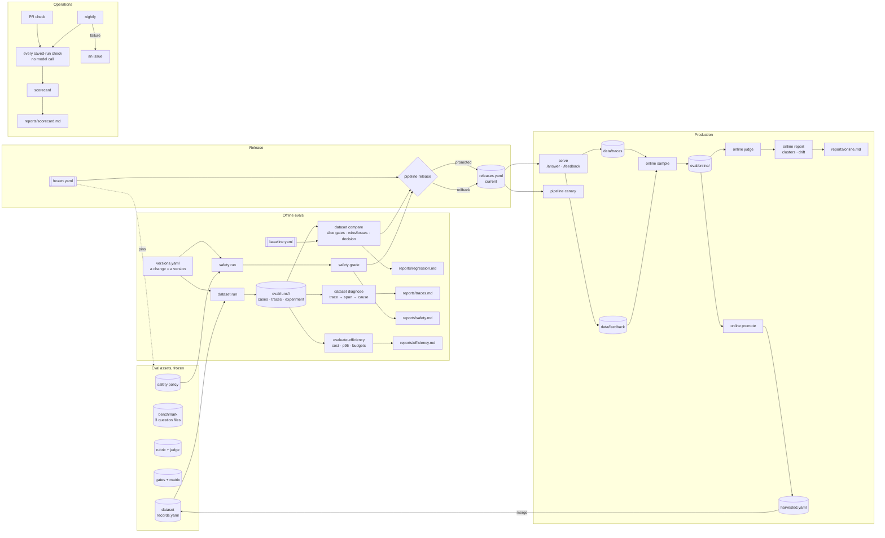

# The evaluation system as a workflow

How the pieces built in stages 08 and 13 to 21 run together: what runs when, what each run reads
and writes, what a failure triggers, and who acts. Everything below is a command in this repository
and a file it leaves behind; the scorecard ([`reports/scorecard.md`](../reports/scorecard.md)) is the
one page that shows the state of all of it.

## The flow

The assets at the top are what a decision is read under; the freeze pins them by content hash and
a change to one is a deliberate `dataset freeze`. Offline evals turn a change into a decision on the
same records every time. Production feeds the dataset back: what people ask that the dataset did not
is sampled, judged, clustered and, when it is a failure worth keeping, written into a record, which
moves the dataset version and sends the baseline around again.

## What runs when

| Trigger | When | Runs | Reads | Writes | On failure |
|---|---|---|---|---|---|
| **A change to the pipeline** | a person adds a version to `eval/versions.yaml` | `dataset run --version <name>` (a model call per record, ~35 min); `safety run --version <name>` (18 calls) | the frozen dataset and policy, the index | `eval/runs/dataset-<name>-<generator>/`, `eval/runs/safety-<name>-<generator>/`, their traces | the run errors are in the trace log; a record with outcome `error` fails the claim floor and counts as lost |
| **PR check** (`.github/workflows/checks.yml`) | every push to a pull request | lint, tests, the benchmark gates on the two latest releases, the baseline pin check, the freeze check, the committed comparison, the trace diagnosis, the online report, the efficiency report, the safety grades, the judge calibration, the scorecard; then the report drift check | the committed runs, windows and grades; **no model call** | the reports, compared to the committed ones | the check is red: a stale pin or freeze (refreeze or rerun the baseline, deliberately), a report that was not regenerated, a label without a grade, a safety run that blocks the release's version |
| **Pre-release gate** | a person runs `pipeline release --candidate <run>` | the freeze check; the candidate's experiment manifest against the freeze; the candidate version's graded safety run; the benchmark gates against the current release; the index switch | `frozen.yaml`, `safety.json`, `gates.yaml` | `eval/releases.yaml` (the lineage, the experiment, the freeze, the safety run, the verdict) | refused, with what moved or which gate failed; nothing is written |
| **Nightly** (`.github/workflows/nightly.yml`) | 06:00 UTC daily, and on demand | the same saved-run checks as the PR check, plus the scorecard, uploaded as an artifact | the repository as it is on `main` | the scorecard artifact | an issue is opened (or the open one updated) with the failing step, so a drift that landed between PRs has an owner by morning |
| **Post-release monitoring** | after a release; weekly for the window | `pipeline canary --version release` (five known questions); `serve` writes a trace per question and a feedback line per signal; `online sample`, `online judge`, `online report` on the week's traces (a jev call per sampled answer) | the trace log, the feedback log, the baseline's rates | `eval/online/<window>.json`, `reports/online.md` | a canary failure is a rollback (`pipeline rollback`); a drift flag or a recurring cluster is a record to harvest (`online promote`), a floor to move, or a source to ingest |
| **Benchmark refresh** | when a window's failures are worth keeping | `online promote --n 10`, a person's review of `harvested.yaml`, `online promote --merge`; then `dataset run` under the release version, `dataset baseline set`, `dataset freeze` | the window, the passages the service read | `records.yaml`, a new baseline run, `baseline.yaml`, `frozen.yaml` | `dataset check` refuses a record whose contexts do not exist; the PR check refuses until the baseline and the freeze are renewed |

## Ownership

One person owns the evaluation system here (the repository's author); the roles are still worth
naming, because they are what a team would split and what the commands assume:

- **The pipeline change** belongs to whoever proposes it: a version in `versions.yaml`, its dataset
  run and safety run, and the regression report they produce. The decision is the report's, not the
  proposer's.
- **The assets** (the dataset, the rubric, the gates, the policy) belong to the evaluation owner. A
  change to any of them is a `dataset freeze` with a note, in its own PR, never inside a pipeline
  change: a comparison that moves a gate and a retriever at once is confounded, and `dataset compare`
  says so.
- **The release** belongs to whoever runs `pipeline release`; the command refuses more than it
  allows, and the record it writes is the audit trail.
- **Production** belongs to whoever reads the online report each week and the canary after each
  release; the harvest is their call, the merge is the evaluation owner's.

## When a check is red

1. **Baseline stale**: the records changed after the baseline answered them. Run the baseline
   version again (`dataset run --version <release version>`), `dataset baseline set`, `dataset
   freeze`. Not a flag to override.
2. **Freeze moved**: an asset's hash differs. If the change was deliberate, `dataset freeze --note`
   in the same PR; if not, find the edit.
3. **Quality gates block**: read `reports/regression.md`, the losses in full, and
   `reports/traces.md` for the span that broke; fix the cause, not the gate.
4. **Safety blocks**: read `reports/safety.md`; a disclosure is a prompt or a policy problem, an
   unsupported claim on an advice record is the abstention rule not holding.
5. **Budget broken**: `reports/efficiency.md`; the tradeoff rule says what the quality bought.
6. **Report drift**: regenerate the named report and commit it; the check exists so that what is
   committed is what the saved runs say.
7. **Online drift**: `reports/online.md`; the no-answer rate first, then the clusters.
