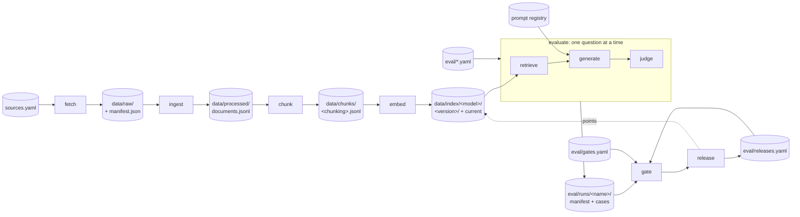

# The pipeline as stages

Every result this service produces (a passage, an answer, a benchmark number) comes out of a chain of
stages, each reading what the one before it wrote. This document is the contract between them: what
each stage reads and writes, where its state lives, what version of it produced a given artifact, and
where a failure stops. `infra-docs-rag pipeline run` executes the chain; `pipeline status` shows where
each stage stands. [`reports/orchestration.md`](../reports/orchestration.md) is the chain exercised:
a run, a failure, a retry, a re-index, a rollback.

## The graph

Solid arrows are data a stage reads or writes. `retrieve`, `generate` and `judge` run once per
question inside `evaluate`, and once per question behind `answer`; they hold no state of their own.
`release` and `rollback` write one file, the release record, and move the index's `current` pointer.

## Stage contracts

| Stage | Reads | Writes | State store | Stage version hashes | Failure boundary |
|---|---|---|---|---|---|
| **fetch** | `sources.yaml` | `data/raw/<id>.<ext>`, `data/raw/manifest.json` | the raw manifest: per source, the URL, the final URL, bytes, sha256 and fetch time; or an error and its time | the `--refresh` flag | One URL failing is written to that source's manifest entry and the next source is still fetched; the manifest is written after every source. The stage ends failed, with the count and the first three reasons; the retry downloads only what has no sha256. A path source cannot fail here. |
| **ingest** | `sources.yaml`, the raw files, the raw manifest | `data/processed/documents.jsonl`, `pairs.json` (duplicates) | each record's provenance: source sha256, parser, `ingest_version` (package version and commit), time | nothing but the code | A damaged, encrypted, blank or navigation-only file becomes a record with `parse_status` `failed` or `empty` and a reason; the run goes on. The stage fails only when a raw file is missing. Output is written to a staging directory and renamed into place, so a failed stage leaves the previous records. |
| **chunk** | `documents.jsonl`, the embedding model's tokenizer | `data/chunks/<chunking>.jsonl` and its `.manifest.json` (chunking, chunking version, tokenizer, ingest version, counts) | the chunks file is named by the chunking, so two chunkings coexist | the chunking (strategy, size, overlap, context) and the model whose tokens size it | Only usable records are cut (parsed, not a duplicate). No chunk at all is a failure. Written through staging. |
| **embed** | the chunks file, `documents.jsonl` (for the ingest version) | `data/index/<model>/<version>/` (vectors, chunks, manifest), `data/index/<model>/current` | one directory per index version, named by the hash of its content; `current` names the live one | the model and the chunking | The index is built into a staging directory next to the live one and checked: it reloads, it holds every chunk given in order, a chunk's own text finds that chunk first. A check that fails removes the staging directory and leaves `current` as it was. The same content twice is the same version: nothing is rebuilt, `current` is repointed. Earlier versions stay until `pipeline index --remove`. |
| **retrieve** | the index named by the version (current, or pinned), a BM25 index built from the same chunks at load, the reranker | nothing; a `Context` in memory | – | – (part of the retrieval version: k, floor, mode, fusion, rerank) | An embedder that is not the index's is refused before any query. A reranker other than the retrieval asks for is refused. A question whose best hit is under the cosine floor returns no passage: the fixed abstention sentence, with no model call. |
| **generate** | the context, the prompt from the registry | nothing; an `Answer` in memory | – | – (the prompt version: name and hash of its wording) | The model's refusal or token limit becomes an outcome (`refused`, `cut-off`). Inside a benchmark, a call that raises is tried once more and then recorded as outcome `error` with the reason; the run continues. From `answer` it propagates, so the caller sees it. |
| **judge** | the context, the answer | nothing; a `Judgement` in memory | – | – (the judge model, in the run manifest) | A judge that fails leaves the case with no reading, printed, not fatal: the judge changes no verdict. |
| **evaluate** | the index, the benchmark files (`eval/retrieval.yaml`, `hybrid.yaml`, `grounding.yaml`), the generator, the judge | `eval/runs/<name>/manifest.json` and `cases.jsonl` | the saved run, committed; its manifest carries the lineage | the pipeline version, the retrieval, the prompt version, the generator, effort, limit, judge | One question's failure is one case (see generate). The run is written at the end, whole: a stage that dies leaves no half run. |
| **gate** | the run, `eval/gates.yaml`, `eval/releases.yaml` | `reports/evaluation.md` | – | – | Compares the run to the current release's run. A critical gate that fails stops the pipeline with exit 1; the release record is untouched. |
| **release** / **rollback** | a saved run, the gates, the release record | `eval/releases.yaml`, `data/index/<model>/current` | the release record, committed: every release with its lineage and the verdict that let it in; `current` names the live one | – | A candidate that fails a critical gate is refused and nothing is written. A rollback makes the previous release current and repoints the index when that version is on disk; when it is not, it says so and leaves the index alone. |

Validation between stages is the Pydantic model each artifact is read through: `Document`, `Chunk`,
the index `Manifest`, `Run` and `CaseRecord`, `Version`, `Release`. A file that does not parse stops
the stage that reads it, not the one that wrote it, with the field that failed.

## What is versioned, and how

Every version is a pinned id or a hash of content, never a label someone has to remember to bump.

| Version | Looks like | What it hashes or pins |
|---|---|---|
| `ingest_version` | `0.1.0+8e4b1a0` | the package version and the commit the records were produced at (`.dirty` when uncommitted) |
| `chunking_version` | `section-aware-512-64-context+825a7940b716` | the chunking's label, then every setting |
| `embedding_version` | `BAAI/bge-small-en-v1.5@5c38ec7c405e` | the model and the Hugging Face commit it is pinned to |
| `index_version` | `3971d9f1e10e` | the vectors, the chunks and the manifest fields that say how they were made (build time left out, so a rebuild of the same content is the same version) |
| `prompt_version` | `cite-v1+e732a9f0cc40` | the prompt's name in the registry, then the hash of the wording the backend gets (the typed-citation wording for `claude -p`, the API wording otherwise) |
| `retrieval_version` | `v2-hybrid-rerank+cc59ba7751e4` | the pipeline version's name, then the retrieval configuration |
| `eval_run_id` | `v2-hybrid-rerank-claude-code` | the saved run under `eval/runs/` that measured the pipeline |

These seven, plus the generator and how it was called, are the `PipelineManifest`
(`pipeline/manifest.py`). It sits on every saved run as `lineage`, and on every release. Two runs
whose lineages differ in one field differ in exactly that stage, which is what `pipeline rollback`
prints as "what changed".

A **pipeline version** in [`eval/versions.yaml`](../eval/versions.yaml) is what the benchmark and
`answer` run under: a retrieval configuration, a prompt name, the embedding model whose index is read,
and, optionally, a pinned index version. Unpinned, a version reads the model's current index, and the
run records which one that was.

A **stage version** is what the orchestrator hashes to decide whether a stage is up to date: its
configuration (the chunking for `chunk`, the model and chunking for `embed`, the whole pipeline
version for `evaluate`). The code itself is not hashed; `pipeline run --force` reruns after a code
change that changes an artifact without changing its configuration.

## Skipping, retrying, re-indexing, rolling back

**Up to date.** Before a stage runs, its inputs are fingerprinted: the content identity of each
artifact (the sha256s in the raw manifest, the content hashes and parse statuses of the records, the
bytes of the chunks file, the current index version), not a timestamp. The stage is skipped when its
last recorded run was `ok`, under the same stage version, with the same input fingerprints, and its
outputs are still what it wrote. Rewriting a file with the same content, which ingest does on every run
(only the ingest time differs), is not a change downstream.

**Failure.** A stage that raises is recorded as `failed` with the error and the traceback, nothing
after it runs, and `pipeline run` exits 1. `pipeline status` shows the stages after it as stale.
The next `pipeline run` starts where it stopped: everything before is up to date and skips itself.
`--only <stage>` runs one stage; `--from` and `--to` select a range.

**Re-indexing.** `embed` never touches the live index until the new one has passed its checks; the
switch is one small file. `pipeline index --list` shows every version of a model with its chunking and
build date, `--use <version>` makes one current, `--remove <version>` deletes one that is not current.
`Index.load` follows `current`, so every command that reads the index reads the live version.

**Releases.** `pipeline release --candidate <run>` compares the run to the current release's run with
the gates in [`eval/gates.yaml`](../eval/gates.yaml) and, when no critical gate fails, appends a release
with the run's lineage and makes it current. The first release has nothing to compare against and is
accepted as the baseline. `pipeline rollback` makes the previous release current and points the index
at its index version. `answer`, `retrieve` and `search` run the current release's version when they
are given no retrieval flag and no `--version`; a flag wins, `--version <name>` runs a named version,
`--version release` is explicit.

## What is not here

- **Scheduling and workers.** Stages run in one process, in order. Airflow or Dagster would own the
  schedule, the retries with backoff and the fan-out over sources; the stage contracts above are what
  their tasks would wrap.
- **Remote state.** State is files in the repository and under `data/`. A second machine has its own
  `data/pipeline/state.json`; the committed artifacts (runs, releases, versions, gates) are the shared
  truth.
- **Concurrency.** Two `pipeline run`s at once would race on `current` and on the state file. One at
  a time, by convention.
